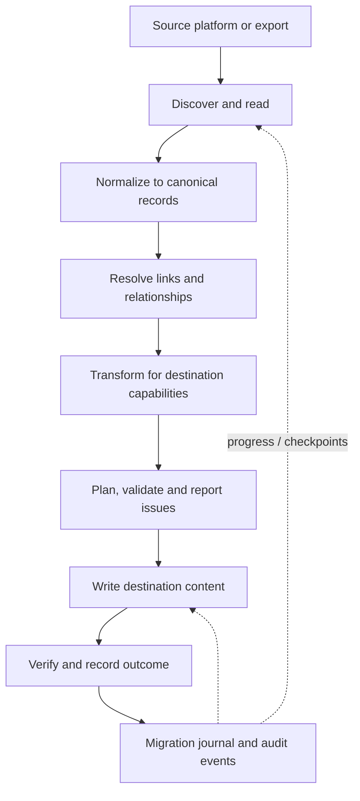

# AIME — AI Migration Engineer

**Move knowledge between platforms without treating migration as a blind copy.**

AIME is an extensible data-migration engine that discovers source content, converts it into a portable representation, resolves relationships, applies destination-aware transformations, and produces migration records that help people understand what changed and what needs attention.

[Overview](#what-aime-does) · [How it works](#how-it-works) · [Capabilities](#capabilities) · [Design principles](#design-principles) · [Documentation](#documentation) · [Contributing](CONTRIBUTING.md)

---

## What AIME does

Moving information between applications is rarely just copying files. Pages may link to other pages, databases contain relationships, attachments live separately, and each destination supports a different set of content features. A migration can finish successfully while still losing meaning.

AIME is designed to make that process explicit. It separates source discovery, content normalization, relationship resolution, transformation, destination writing, and reporting so a migration can be reasoned about as a sequence of defined operations.

Its original end-to-end path converts a **Notion export ZIP into an Obsidian-compatible Markdown vault**. Alongside that path, AIME includes a canonical JSONL archive bridge and platform building blocks for live provider access, credentials, jobs, identity, and synchronization.

## Why AIME exists

- **Preserve meaning, not just bytes.** Content is transformed with awareness of links, embeds, callouts, toggles, metadata, and attachments.
- **Make loss visible.** Unsupported features and unresolved references should be surfaced as issues instead of silently disappearing.
- **Keep migrations inspectable.** Plans, checkpoints, reports, hashes, and audit events provide evidence about the work performed.
- **Avoid destructive surprises.** Dry-run planning and guarded writes help operators review the expected result before committing changes.
- **Build for more than one pair of platforms.** Shared adapter contracts and canonical records give future connectors a consistent foundation.
- **Keep people in control.** Conflicts and ambiguous transformations should be visible and reviewable rather than guessed silently.

## How it works

### 1. Discover

A source adapter enumerates the content available to the migration and gathers its metadata. Source-specific API and export details remain inside the adapter rather than leaking into the shared transformation logic.

### 2. Normalize

Content is represented in a canonical envelope so later stages can work with consistent identifiers, content, metadata, and hashes. This creates a boundary between how a platform stores information and how AIME reasons about it.

### 3. Resolve relationships

The pipeline builds and rewrites internal links, maps source identifiers to destination paths, and handles content relationships that would otherwise break when content moves.

### 4. Transform

Composable transformations convert source-specific constructs into destination-compatible forms. Where the destination cannot represent a source feature exactly, the migration should record the limitation instead of implying perfect equivalence.

### 5. Plan and write

Migration planning separates validation and transformation from destination writes. Existing-output protections and dry-run behavior reduce the chance of accidental overwrites. The writer then materializes the planned content.

### 6. Record and inspect

A migration journal records job lifecycle information, stage checkpoints, and audit events. Reports surface unresolved links, conversion issues, and outcomes so the destination can be reviewed instead of trusting a successful exit code alone.

## Capabilities

| Capability | What it provides |
|---|---|
| Notion export → Obsidian | End-to-end conversion of a Notion export ZIP into a Markdown vault |
| Content transformations | Link rewriting, embeds, callouts, toggles, frontmatter, synced-block expansion, and attachment paths |
| Canonical JSONL | Portable records with validation and SHA-256 integrity checks for file-oriented migration workflows |
| Migration journal | SQLite-backed job records, stage checkpoints, and audit events |
| Live Notion access | API-based page discovery and export into canonical JSONL |
| Google Drive integration | Provider API operations for listing, reading, exporting, creating, updating, and deleting supported files |
| Credential protection | Tenant/provider-scoped AES-256-GCM encrypted credential storage |
| OAuth primitives | Authorization-code and PKCE helpers for provider connection flows |
| Identity and permissions | Organization membership and role-based access-control services |
| Job execution | Durable queue implementations, lease-based claiming, worker heartbeats, retries, and checkpoints |
| Synchronization foundations | Persisted baselines, change comparison, conflict decisions, deletion policies, and recoverable write intents |
| Interfaces | CLI, local web dashboard, HTTP endpoints, and an MCP server for agent workflows |

AIME's connectors and platform capabilities are not all at the same maturity level. The original Notion-export-to-Obsidian workflow is the core end-to-end migration path. Other services provide live API operations or reusable platform primitives; support for a provider should not be interpreted as feature-perfect, lossless, bidirectional parity for every content type.

## Design principles

### Adapters own provider-specific behavior

Source adapters discover and read content. Destination adapters validate what the target can represent and perform writes. Shared pipeline stages should not need to know the details of every provider API.

### Canonical records separate content from transport

A provider API response, a ZIP export, and a filesystem archive are different transport formats. Canonical records give the engine a common representation that can be validated, hashed, transformed, and exported.

### Migration is a process, not a single copy operation

Discovery, transformation, writes, and verification are distinct stages. Keeping those stages explicit makes issues easier to diagnose and makes recovery strategies possible to add without embedding them into every connector.

### Conflicts deserve explicit decisions

Two systems can change the same item independently. Hashes and common baselines help identify changes, but they cannot decide every semantic conflict. AIME's sync logic is designed to distinguish safe propagation from conflicts that require a policy or human decision.

### Security boundaries must be deliberate

Tenant identity, authorization, provider credentials, job ownership, and destination writes are security-sensitive. Encryption alone does not replace access control, key management, provider scopes, deployment hardening, or operational monitoring.

## Where AIME fits

AIME is intended for engineers and teams building repeatable migrations between knowledge tools, document systems, and file-oriented stores. It is also a foundation for agent-assisted migration workflows where a model can inspect capabilities and invoke migration tools, while deterministic pipeline stages handle the actual data operations.

AIME is not a promise that every application can be migrated losslessly. Provider APIs differ, and some concepts—permissions, comments, revision history, database semantics, formulas, and embedded objects—may not have equivalent representations in a destination. Those differences need explicit mapping and review.

## Requirements

- Node.js 22.13 or newer, because AIME uses the built-in `node:sqlite` API.
- npm 10 or newer.

## Documentation

- [Production Platform Guide](docs/PRODUCTION_PLATFORM.md) — identity, provider connections, workers, configuration, and platform boundaries.
- [Reliability Guide](docs/RELIABILITY.md) — migration journaling, checkpoints, and reliability semantics.
- [Security and Distribution](docs/SECURITY_AND_DISTRIBUTION.md) — credential handling, trust boundaries, and deployment considerations.
- [Adapter SDK](docs/ADAPTER_SDK.md) — contracts and principles for adding source/destination adapters.
- [Integration Strategy](docs/INTEGRATION_STRATEGY.md) — connector expansion and interoperability direction.
- [Roadmap](ROADMAP.md) — planned evolution.
- [Changelog](CHANGELOG.md) — notable release changes.
- [Specification](SPEC.md) — project requirements and behavioral expectations.

## Open source

AIME is distributed under the [MIT License](LICENSE). Contributions, bug reports, connector proposals, and documentation improvements are welcome. Please read [CONTRIBUTING.md](CONTRIBUTING.md) and the [Code of Conduct](CODE_OF_CONDUCT.md) before participating. Security-sensitive reports should follow [SECURITY.md](SECURITY.md).

---

**AIME — migrations you can inspect, reason about, and improve.**

