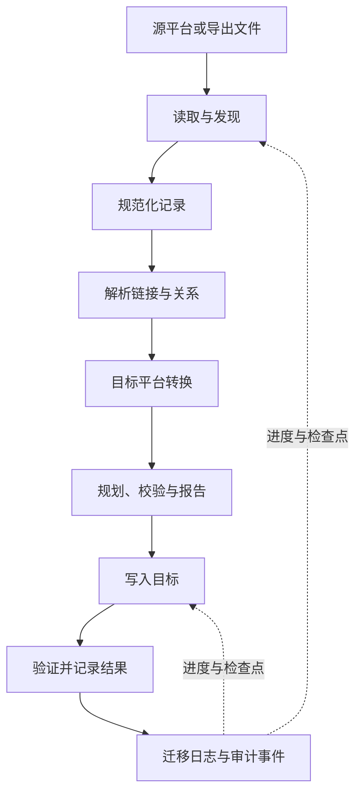

# AIME — AI Migration Engineer

**让跨平台迁移不再只是盲目复制。**

AIME 是一个可扩展的数据迁移引擎，用于发现源数据、规范化内容、解析关系、执行目标平台转换，并记录迁移结果与需要关注的问题。

---

## AIME 能做什么

跨应用迁移不只是复制文件。页面之间存在链接，数据库包含关联，附件独立存储，而不同目标平台支持的内容能力也不相同。迁移即使成功结束，也可能丢失原有语义。

AIME 将迁移拆分为可检查的阶段：读取数据、规范化、关系解析、内容转换、目标写入和结果报告。当前核心端到端流程是将 **Notion 导出 ZIP 转换为兼容 Obsidian 的 Markdown 知识库**。

## 主要能力

- **内容转换：** 处理链接、嵌入内容、提示块、折叠块、frontmatter 和附件路径。
- **关系保留：** 解析页面关系并重写内部链接，减少迁移后的断链。
- **可移植记录：** 使用规范化 JSONL 记录，为文件型迁移流程提供统一数据表示。
- **迁移日志：** 通过 SQLite 记录任务状态、阶段检查点和审计事件。
- **预览与防护：** 支持 dry-run，并在默认情况下拒绝写入非空目标目录。
- **平台扩展能力：** 提供 Notion、Google Drive、凭据加密、OAuth、身份权限、任务队列和同步基础模块。
- **多种接口：** 提供 CLI、本地 Web 接口和 MCP 服务端能力。

各连接器和平台模块的成熟度并不完全相同。Notion 导出到 Obsidian 是当前核心端到端路径；其他模块提供 API 操作或可复用的平台基础能力，不代表所有内容类型都能无损迁移或双向同步。

## 工作流程

## 设计原则

- **保留语义，而不仅是字节：** 关注链接、元数据、附件和内容结构。
- **明确呈现损失：** 无法转换的特性和未解析的引用应当被记录，而不是被静默忽略。
- **让过程可检查：** 任务日志、检查点、哈希和报告帮助理解迁移执行情况。
- **避免意外覆盖：** 使用 dry-run 和目标目录保护机制降低误操作风险。
- **明确处理冲突：** 不将哈希比较等同于语义判断；不确定的冲突应交由策略或人工处理。

AIME 不承诺所有应用之间都能完全无损迁移。权限、评论、历史版本、公式和嵌入对象等内容在不同平台之间可能没有等价表示，需要明确映射与复核。

## 环境要求

- Node.js 22.13 或更高版本（使用内置 `node:sqlite` API）
- npm 10 或更高版本

## 文档

- [平台指南](docs/PRODUCTION_PLATFORM.md)
- [可靠性指南](docs/RELIABILITY.md)
- [安全与分发](docs/SECURITY_AND_DISTRIBUTION.md)
- [适配器 SDK](docs/ADAPTER_SDK.md)
- [集成策略](docs/INTEGRATION_STRATEGY.md)
- [路线图](ROADMAP.md)
- [项目规范](SPEC.md)
- [贡献指南](CONTRIBUTING.md)

## 开源

AIME 使用 [MIT License](LICENSE)。欢迎提交问题、连接器提案、文档改进和代码贡献。参与前请阅读 [贡献指南](CONTRIBUTING.md) 与 [行为准则](CODE_OF_CONDUCT.md)。安全问题请遵循 [SECURITY.md](SECURITY.md) 中的说明。
